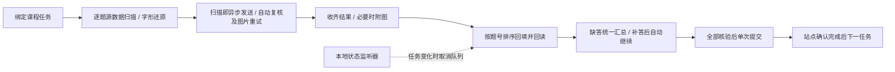

# 课程任务自动运行（2026-10-19）

## v0.2.4 签到表与双栏查看（2026-10-20）

列表改为紧凑题号：绿＝普通源文字，蓝＝图像依赖/整图重试，红＝最终仍未回填（最高优先级，补答核验成功后恢复读取颜色）。点击题号或补答卡片的查看按钮，在同一弹窗左看Markdown、右看完整图片；异步预览不调用模型。原尺寸查看、复制下载和前后题切换保留。取消独立版本地图像400KB拒绝与原图编码合计预算；原图PNG优先保留分辨率，仅极大画布按资源预算分配，实际供应商/浏览器限制仍可能报错。见[说明](question-board-0.2.4.md)。

## v0.2.3 增量扫描与可操作界面（2026-10-20）

本版运行路径逐题扫描后立即异步发送，收齐答案后按题号回填；不等待整卷。首次拒答、上下文不足或可恢复输出错误，及共识仍未决，均先自动后台整题图片重试；第二阶段仍失败才人工补答。运行中可以预览复制，任务模式下拉统一启动。详见 [验证说明](async-scan-ui-0.2.3.md)。此更新覆盖下方旧版整份读取后发送与直接人工的描述。

## v0.2.2 整题图片直填与逐题录入（2026-10-20）

The image stage replaces earlier votes with one full-question image response. Each pending question has two main actions: image retry/write and direct entry of the displayed, editable answer.

首次缺上下文/看不清/输出不可用，第二阶段强制完整题干＋全部选项图；可映射的图片回答直接回填，不再与旧样本投票，允许不确定说明但不允许缺答或无效ID。选项旁附固定opt_N标记，图示和文字读取复用已支持的option-list结构。图片无法生成/模型不支持时明确失败，不把图片阶段改发文字。该规则覆盖下方旧的图片二次共识/原图投票描述。

待补答先展示模型回答，两个主要按钮「采用图片重新发送并回写」「一键录入本题」；下方预填候选可修改。逐题录入不再要求全部题一次填完，当前题显示错误/成功，其他题变化不清空已输入草稿。全部核验后再自动提交；ERROR停止后也能图片补答恢复，停止中的请求返回不再继续写入。详见 [流程与验证](image-retry-entry-flow.md)。

## v0.2.1 延迟填空修复（2026-10-20）

Capture counts stable blank slots without opening editors. Filling activates each slot and waits for its editor. Full question text is sent with an exact per-blank template.

真实页面的 `.InpDIV` 与隐藏 `.textDIV` 组合会让“只数可见编辑器”漏空，并让指纹随活动编辑器变化。现按已取证的稳定位置读取，逐空回填；资料题/分录题符合该布局时也按填空，不再只给一个简答。完整题干、程序和所需题图沿既有通道发送，并附准确空格数量及固定JSON模板。漏空重试，不拆分/猜测单段答案。必须关闭旧运行页、重载扩展并刷新课程后重新读取，旧缓存不会自动纠正。证据见 compatibility §6.8、[本次修复](blank-editor-fix-2026-10-20.md)。

## v0.2.0 答案校验与更新（2026-10-20）

Strict answer fields and blank identities are checked before writing. Uncertain results get two additional samples; automatic filling requires a majority. Update controls are available in all extension pages, with manual reload for unpacked installations.

按用户最新反馈，本版不再把无多数投票的首个候选自动写入：明确结果一次调用，声明不确定时追加两次；三份结果至少两份答案一致才自动回填，分歧/并列转人工汇总。此规则覆盖下文历史“无多数时采用最高票候选”的描述。不同多选候选永不取并集。资料题多框按明确 blankId 写入；对象/数组填空、跨题型混合字段、未知状态拒绝，格式纠正最多 3 次；控件标识/顺序变化时重新读取，不沿旧定位写入。

更新入口位于侧边栏、设置页、调度页顶部。ZIP 用户先配置发布者的 update.json 地址，检查并下载新版后停止任务、覆盖原加载目录、重载扩展并重开调度页；不会在运行中自动重启。发布过程见 [extension-updates.md](extension-updates.md)，本轮完整验证与限制见 [project-audit-2026-10-20.md](project-audit-2026-10-20.md)。

## 授权与适用范围

用户在本轮明确要求“回填提交并进入下一个任务，视频就播放，但鼠标可以自由移动”，确认后再次要求执行。此授权新增独立的课程运行模式：一次启动确认允许在绑定课程标签中连续调用默认供应商、回填和提交已适配章节任务。原手动侧边栏模式仍保持逐题审核及计分页拒绝。正式考试、未知任务和无法核实的结果停止；不伪造进度、时长、签到、事件可信性，不读取站点 Cookie 或密码。

## 使用

1. 在 Chrome 扩展管理页重新加载 `apps/extension/dist`，再刷新课程标签并重新打开调度页，清除旧文档中的注入监听器。
2. 在课程任务标签打开侧边栏（本地直连已配置即可，无需登录），点击“打开课程任务调度”。调度页绑定原标签 ID，不跟随活动标签切换。
3. 调度页显示默认本地供应商的模型名；本地直连显示“配置已保存”，并不代表已做过供应商验证，以设置页「测试连接」为准。图片题需要供应商支持图像输入（设置页勾选「支持图像输入（多模态）」）。必要时核对并授予具体 HTTPS 课程站点可选权限。
4. 进入读取页后自动读取整份题目的源数据（不调用模型），也可点击“读取全部题目（不发送）”刷新。列表显示题干、选项和图像兜底原因。原侧边栏“读取当前题目”在已识别的课程 URL 上直接打开此读取页，不再走旧手动适配入口。
5. 可选“从第几题开始”，默认1。勾选本次运行授权，在「任务模式」下拉列表选刷课（视频＋题目）、刷题（仅题目）或只刷课（仅视频），再点「开始运行」。
6. 启动后按题读取源数据并立即发送，不等待整卷扫描；请求并发最多2，图像处理最多2，三个工作者流水消费。确定答案直接采用，普通不确定答案追加两次共识；上下文不足/看不清/格式输出失败自动进入完整题干＋所有选项图像阶段，直接用该次合法完整答案；共识仍未决也自动图片重试。首次REFUSED也先自动整题图片重试；第二次仍拒答才汇总，不无限重发。全部结果汇总后按题号回填并逐题回读。
7. 自动处理结束仍失败才显示人工汇总：先显示模型回答，每题保留「采用图片重新发送并回写」与「一键录入本题」；草稿可修改且互不清空。所有题补全核验后自动提交和继续。缺题不提交；正式考试、未知页面、任务变化等原有边界保留。
8. 运行期间仍能展开源题、复制/下载Markdown、异步读取/查看题图。题图使用本任务缓存或独立的单题读取，不调用模型、不取得系统鼠标。长文本图片渲染每128字交回浏览器处理输入与绘制。
9. 暂停/停止阻止后续动作，已发出的请求无法撤回。错误或人工补答会显示文字并按已选项声音提醒。设置、启动模式与网页写操作仍互斥，避免重复提交。

## 并行、投票与监听

2026-10-20最新要求覆盖旧版“全部读完再发”：运行中逐题扫描即发送，等待答案汇总后按题号写入；第二阶段整题图片自动后台执行，最终仍无法处理才人工输入。预览扫描不发送模型，启动必须一次授权。



- 预览用`READ_ALL`只读整份题目；运行用`READ_ONE`复用相同源读取器，每题都绑定课程、任务与索引，限制最多200题。已有只支持READ_ALL的端口保留兼容；生产调度页支持增量读取。题文、答案只在内存，模型请求期间可继续只读预览和复制。

- `font-cxsecret` 的内嵌 TrueType `cmap/loca/glyf` 通过唯一字形 SHA-256/128 指纹匹配思源黑体 Unicode 索引；不执行字体代码、不下载站点字体。未知、歧义或不匹配字形回退为图像；图示题补充图片和已还原文字。
- 真实页已读取 37 题；内嵌字体 62 个映射全部精确匹配，题干解码 67 处、未匹配 0 处。25 题无图示、12 题有图示。此为读取证据，不是答案或提交成功证据。索引 28501 条唯一字形指纹约 1.17 MB，不分发完整字体；参考 [Source Han Sans](https://github.com/adobe-fonts/source-han-sans)，[OFL 许可](https://github.com/adobe-fonts/source-han-sans/blob/master/LICENSE.txt) 随产物附带。
- 请求并发为 `min(2, /meta.limits.perUserConcurrency)`。有效确定答案直接采用；仅不确定或结构不完整时追加两次。图片不清自动整题图片重试；首次拒答也自动整题图片重试，二次仍拒答才最终汇总。复核仍需至少两份有效一致答案，不删除 caveats 强行通过。
- 投票只比较有效答案数据，忽略推理措辞和选项顺序；填空按 ID 对齐，文本只统一外部/重复空白。选择题必须是有效选项，填空必须齐全。三方分歧、无多数或结构不全进入人工清单；简答的不同表达不会被任意当作语义相同。
- `2/3` 是一致比例，不是正确概率。复核仍无多数时进入最后的人工清单；超时、网络、每日额度错误停止，不自动重试未知结果。
- 移除每题固定 6.5 秒回填等待，回填回读通过即可消费下一题。请求发送按全局滚动 61 秒窗口节流，暂停后恢复仍在真正发出时计数；同一运行页重启任务保留最近窗口的计数。跨页/其他客户端的共享额度以服务端拒绝为准。
- 本地直连没有服务端配额；运行页仍按自身并发（默认 2）与可选每分钟节流执行。37 题全部明确时为 37 次，另按不确定题最多每题加 2 次，图像读取失败不调用模型；未扩大或绕过供应商自身限制。
- 起始题 N 仅用于首次遇到的题目任务，后续任务重置为 1。N 之前通过 `ADOPT_EXISTING` 检查已有答案结构、记录指纹/摘要，提交前再次回读；不修改、不重发模型。原答缺失进入人工清单，不能假设已答完。
- 本地“总监”是确定性的状态监听器，不依赖模型生成浏览器动作。答题时每 2.5 秒检查绑定课程、任务键、题数；只允许一个检查在途，变化即停止后续回填/发送。视频每 2.5 秒检查暂停、错误、实际播放进展和站点完成，60 秒无进展停止；用户主动暂停不计入停滞时间。
- 暂停会唤醒/恢复所有排队等待者；停止后取消未发出的工作并等待在途请求收尾，不采用迟到答案。任务切换后原持有者仍能释放旧租约，不触碰新任务的播放器，也不能释放另一个运行器的租约。
- 刷题模式连续完成任务点，遇到未完成视频直接跳过、不播放；刷课模式播放视频并处理已适配题目，运行到站点末尾。`#iframe` src 的卡片序号 `num` 参与任务键，支持同章多卡片。仅允许越过已识别 PDF 模块且无任务标记的资料页，不计作任务完成；有未完成标记的资料、未知任务或验证码仍停止。
- 实际视频页验证了 `/ananas/modules/video/index.html`、`video#video_html5_api`、`.vjs-big-play-button` 和任务标记。懒加载源先点击站点按钮、有界等待元数据，再用标准播放；加载后重读时长，避免初始 0 时长导致长视频十分钟误停。真实播放进展已确认，完整观看及完成回执尚未验收。
- 当前未观察到真实视频弹题表单，仅有可选 AI 题按钮；不能将其当作已适配的强制弹题。2026-10-19 22:4x 起视频弹题按用户授权做**结构性枚举作答**（见下文专节）：可见小容器＋互斥选项控件即可枚举，识别不到即按暂停处理，绝不猜测学习通弹题类名。已适配章节题可自动处理。后台节流可能延迟检查，关闭运行页后不继续调度。

## 不漏题：无多数时填最高票（2026-10-19 20:5x）

- 三次采样没有严格多数时，只要存在结构有效的候选答案，就自动填命中次数最多的答案，并在投票栏显示如 1/3，页面不再留空。
- 只有完全无有效答案（图片不可读、模型拒绝、选项 ID 全不成立、无选项可写）才进入人工清单；此时题目会明确显示原因。
- 带 caveats 的答案仍参与投票与回填（上一小节），避免“模型三次都答同一项却因备注被丢弃”。

## 提交阶段可见性与跨文档按钮（2026-10-19 20:4x）

- 提交按钮在“题目文档”找不到时，会遍历全部同源文档并去重；失败信息包含候选数量与搜索文档数，避免只报“无法确认”。
- 点击提交后步骤栏显示倒计时“已点击提交，等待站点确认（剩余 N 秒）”，不再出现无反馈的长时间停顿。
- 若 60 秒内站点没有完成标记、也没有自动切换任务，会明确停止并提示人工检查，不重复提交。

## 提交按钮、站点自动切换与刷题模式（2026-10-19 20:3x）

- 提交按钮：老皮肤 `a.btnSubmit` 之外，支持可见的 `button/a/input` 且文本或 value 恰为 Submit/提交/提交答案/交卷/确定提交（必须唯一，Save 不会被点）。
- 站点自动切换：提交/确认后若任务键自行变化，视为站点已完成并自动进入下一任务，不再报“提交期间任务已变化”，也不再重复点 Next。站点在提交后立即换页时，绑定旧任务键的确认指令失败不会把已接受的提交误报为失败。
- 提交确认弹窗：仅自动确认“Submit?/确定提交”这类提交问句；若弹窗提示“还有 N 题未作答/未完成，确定提交吗？”，扩展不会点确定，而是让运行停止等待人工（缺题不提交）。
- 刷题模式：连续完成任务点，视频任务不播放、不等待，直接进入下一任务并在统计中计为跳过；刷课模式才播放视频。
- 隐藏/折叠的任务卡仍通过任务键与 Next 推进；若站点不会因此加载目标任务，需要提供该页结构再适配。

## 标准化测验皮肤（radio/checkbox）（2026-10-19 20:2x）

- 新增对“题干 + 真实 radio/checkbox 选项行”布局的读写：选项行优先点击内部 input/label，回读按 input.checked、aria-checked 或 checked/selected class 判定，不再只依赖隐藏 answer 输入。
- 老皮肤（隐藏 answer 字符串）与混合布局同时支持；两者都读不到时才判定该题无法回填。
- 仍不支持：跨域 iframe 内的题目、Canvas/SVG 编辑器、非 UEditor 富文本、跨域图片不允许匿名读取、以及完全未知的选项控件。

## 标准化测验皮肤（radio/checkbox）（2026-10-19 20:2x）

- 新增对“题干 + 真实 radio/checkbox 选项行”布局的读写：选项行优先点击内部 input/label，回读按 input.checked、aria-checked 或 checked/selected class 判定，不再只依赖隐藏 answer 输入。
- 老皮肤（隐藏 answer 字符串）与混合布局同时支持；两者都读不到时才判定该题无法回填。
- 仍不支持：跨域 iframe 内的题目、Canvas/SVG 编辑器、非 UEditor 富文本、跨域图片不允许匿名读取、以及完全未知的选项控件。

## 图片优先模式（2026-10-19 20:1x 追加）

- 运行页「所有题目都附带渲染图片」默认开启：每题都渲染题干/公式/图示/选项后随请求发送，文字仍作为辅助。
- 选项映射：当页面不使用 `.num_option` 时，按列表行读取并把行内字母（A/B/C…）映射为 opt_1..opt_n；回读时用隐藏输入的字母比对，兼容无 data 属性的行。
- 图片只解决模型理解，回填仍需要可点击的选项行；完全没有选项行时该题进入人工补答。

## 选项读取与坏题隔离（2026-10-19 20:1x）

- 选项读取在 `.Zy_ulTop .num_option` 之外增加列表行兜底（`.Zy_ulTop > li`、`[class*='ulTop'] > li`、题目内带文字的 `ul > li`），适配同章不同皮肤的多选题。
- 选择题/判断题若仍读不到任何选项：不调用模型，直接进入待人工补答（避免模型输出不存在的选项 ID）。
- 单题级模型失败（UPSTREAM_INVALID_OUTPUT、UPSTREAM_TRUNCATED、VALIDATION_ERROR）改为进入人工清单并继续其他题；网络、超时、限额等全局错误仍整轮停止。

## 消息冲突排查（2026-10-19）

用户报告 `unsupported page command type`：旧手动页面入口在同一文档中仍监听所有扩展消息，收到 `AUTOMATION_PAGE` 时先返回 `INVALID_COMMAND`，与课程入口竞争 Chrome 单次响应。修复为手动监听器只接收四个归属自己的命令，其他消息返回 false 且不调用响应回调；课程入口继续只接收 `AUTOMATION_PAGE`。未扩大指令白名单、权限或执行能力。

“当前页面没有已验证的适配器”的 Fixture-only 引导属于旧手动模式，已更新为区分手动读取与独立课程调度入口。该提示不证明课程适配器运行成功。新增单元测试覆盖不占用自动化响应通道、拒绝外部发送者和保留手动命令校验；MV3 用例先在同一文档执行手动读取，再运行三种题型的课程流程。

当前浏览器连接的安全策略不允许观察 `chrome-extension:` 页面，不能用其他通道绕过。真实调度页预览与提交结果仍需用户在 Chrome 内确认，合成浏览器测试与真实课程结果分别记录。

## 判断题回读、题型兜底与监控诊断（2026-10-19 21:2x）

- 真实运行反馈：判断题回填后进入人工补答，原因「页面没有保留回填结果（回读不一致）」。根因是学习通判断题隐藏答案值是布尔语义（`true`/`false` 或 `对`/`错`），旧回读只按字母 A/B 比对，页面实际已选中却永远读不到。
- 现隐藏答案映射同时接受字母（`A`/`AB`）、布尔（`true`/`false`、`1`/`0`）、可见文本（`True`/`False`/`对`/`错`/`√`/`×`）与序号；选项身份同时取自 `data` 属性、行内字母、可见文本与布尔语义，歧义不猜测。
- 回填后轮询回读最长 2.5 秒，可容忍站点异步写回与题目重渲染；必要时重新定位题目元素并补发一次点击/富文本写入。仍失败时错误信息附带脱敏诊断（选项数、隐藏答案值形态、是否有原生选中控件、识别选中数与期望数），不再只说“回读不一致”。
- 题型标签匹配扩充（判断/对错/是非/True or False/T/F 等）；标签缺失时按控件结构推断（两个布尔选项优先判判断题，其次 radio/checkbox）。仍识别不了时不再中止整轮：该题进入人工汇总，用户在「题型纠正」中选择后补答，写入/补答时也会按答案形态推断题型。
- 补答「再次并发请求」逐题隔离：某题仍被页面拒绝只更新该题原因，不中断其他题的重试；只有全部补答核验后才继续提交。
- 监控不再单次采样即停止：发现任务标识/页面类型/题数差异后等 400ms 复核，仍差异才 ERROR，并在错误中列出具体差异（如“题数由 3 变为 0”）；单题瞬时重渲染不会再打断任务。真实任务变化仍停止且不补填、不提交。
- 允许「ANSWERED 且带 caveats」的答案写入，与上文“带 caveats 仍参与投票与回填”一致；非 ANSWERED 仍拒绝。
- 浏览器级回归：`tests/fixtures/automation-judge.html` + Playwright 用例验证判断题 `true`/`false` 隐藏值可从读取到提交完成；MV3 全量 18/18 通过。真实学习通页面仍需重新加载扩展后复验。

## 实现

- `src/automation/runner.ts`：整份读取、异步汇总、排序回填、自动复核、补答恢复及双模式；`source-reader.ts`/`true-type.ts` 还原源文字，`consensus.ts` 验证/投票，`work-pool.ts` 提供有界并发。
- `runner.html` + `src/automation/App.vue`：独立扩展运行页，默认不运行；Token 沿用可信 `storage.session`，运行数据仅内存。
- `background.ts`：只接受本扩展 `runner.html` 发出的固定自动化命令；仅向绑定 tab 的顶层注入固定 `page/automation-entry.js`，不注入模型代码。
- `course-page.ts`：同源文档递归，课程/任务指纹与运行租约；逐题回填回读；完整回读通过才点击唯一站点提交按钮；确认窗口最多点击一次；站点完成标记通过后才点击下一任务。不能把按钮点击当作成功。
- `render-question.ts`：使用当前文档已加载字体和题目图片，在内存 Canvas 中仅渲染题干、公式、图示及选项；无需屏幕截图、鼠标定位或前台屏幕占用。跳过没有可见布局盒/隐藏/无 src 的图片，可见图片先有界等待加载（3 秒）；跨域图片必须正常允许匿名图像读取，否则该题报错转文字回退或人工，不绕过 CORS。
- 视频只调用 HTMLMediaElement 正常播放/暂停；不修改 currentTime/playbackRate、不伪造 ended 或平台进度。必须等站点完成标记；播放结束但平台 60 秒仍未确认，则停止。
- 后端 `StudyQuestion.imageDataUrl` 为可选内嵌 PNG/JPEG（最多 400000 字符），拒绝远程图像 URL；整体 HTTP body 上限改为 524288 字节。Java DTO、TS 类型与 OpenAPI 同步。2026-10-20 起另有可选 `extraImageDataUrls`（最多 2 张原图，同每张限制；所有图像总量保持在 body 上限内，见文末「纯图片题自动原图直发与自动二次处理」）。
- Chat Completions 与 Responses 将图像作为标准多模态内容块发送（主图与附加原图按序成多个 `image_url`/`input_image` 块），文本块不重复 Base64。沿用题目/答案不落库、密钥 AES-GCM、出站 allowlist 与响应验证。

## 脱敏 DOM 证据

2026-10-19 从用户已打开的 Chrome 学习通课程标签只读检查；未保存完整 HTML、题干、答案、课程标识或 URL 参数。该观察证明结构存在，不代表已经通过真实提交验收。

| 结构 | 本次实际观察 |
|---|---|
| 顶层课程页面 | 路径后缀 `/mycourse/studentstudy`；下一任务为 `#prevNextFocusNext`，role=button |
| 同源嵌套框架 | `#iframe` → `iframe` → `#frame_content`；分别为课程卡片、作业模块、章节题目文档 |
| 题目容器 | `div[id^="question"]`，ID 后缀为数字，内部 `.TiMu`；共 37 题 |
| 题型标签 | `.Zy_TItle .newZy_TItle`；Single Choice、Fill in the Blank、True or False、Short Answer |
| 字体 | `.font-cxsecret`，直接 DOM 文本存在编码字形差异，因此发送实际字体渲染图像 |
| 选项 | `.Zy_ulTop .num_option`；`data` 属性为 A/B/C 等；页面绑定的 hidden `input[id^="answer"]` 提供回读值。仅点击可交互选项，不直接改 hidden 值 |
| 编辑器 | `iframe[id^="ueditor_"]` 内同源 `body[contenteditable="true"]`；`.InpDIV` 是站点原生展开入口。只写纯文本并派发 input/change/blur，不执行模型 HTML |
| 提交 | 唯一 `a.btnSubmit`，显示 Submit，站点自身 handler 负责校验与提交 |
| 确认窗口 | `#confirmSubWin`，可见时 `a.bluebtn` 的文字为 OK，Cancel 为独立控件；仅匹配该结构 |
| 任务标记 | `.ans-job-icon[aria-label]`；当前未完成为“任务点未完成”，仅接受明确“任务点已完成”作为继续依据 |
| 图像主机 | 题内图片来自当前站点和 `p.ananas.chaoxing.com`；必须经正常图像加载/CORS 机制读取 |

正式考试没有适配；普通阅读、附件及其他播放器结构尚未获得证据，不会无条件跳过。真实页面回填、提交和视频连续运行的实际结果应单独记入 `docs/acceptance.md`，不能把合成测试当作真实账号成功。

参考：[DeepSeek Vision](https://api-docs.deepseek.com/guides/vision/)、[Chrome Scripting](https://developer.chrome.com/docs/extensions/reference/api/scripting)。

## 本地直连图像输入（2026-10-19 21:5x）

- 真实现象：使用本地直连供应商（设置页配置，非后端）跑课程调度时，待人工补答卡片里的模型回答为「缺少题目图像，无法作答」；同页「复制题目图片 / 下载图片」可用，说明题图已渲染，但请求没有带上图像。
- 根因：`src/local/provider.ts` 的直连请求只发送题目 JSON 文本。`question.imageDataUrl` 由 `CAPTURE` 返回后，直连路径从未把它作为多模态内容块发送，也没有能力开关；后端模式的两个适配器本来就支持图像。
- 修复：Chat Completions 首次请求即发送 `text` + `image_url`（本地 `data:image/`），Responses 发送 `input_text` + `input_image`；文本块不重复 base64。提示词要求“附带图像时结合图像、未附带时不要臆测、看不清返回 NEEDS_CONTEXT”。
- 能力：`LocalProvider.supportsImages`（设置页「支持图像输入（多模态）」），新建与旧存储默认开启，DeepSeek 文本预设默认关闭；调度页显示「图像输入：已开启/未开启」。仍不接受远程图像 URL，题目/答案不落库。
- 验证：`tests/local-provider.test.ts` 6 项覆盖两种协议的图像块、纯文本回退、旧存储默认能力与供应商拒绝图像时的显式提示；扩展 23 文件 / 223 项通过、4 workspace typecheck 通过、dist 重新构建（共享块含 `image_url`/`input_image`）。
- 未验证：真实 4.1 供应商上的端到端请求需用户重新加载扩展后复测。

## 提交确认弹窗文本签名兜底（2026-10-19 22:0x）

- 真实现象：章节测验点击站点 Submit 后弹出新皮肤确认框（用户截图为 `Tip` / `Submit?` / `Cancel` / `Submit`），扩展认不出，60 秒后按“站点未确认提交”停止；每次重跑都卡在同一处。
- 根因：`CONFIRM_WORK` 只匹配已记录的旧 DOM 证据 `#confirmSubWin` + 唯一 `a.bluebtn`「OK」；新弹窗结构和文案都不同。
- 修复：`course-page.ts` 保留旧证据匹配，增加**可见文本签名兜底**（不使用站点类选择器）：同一可见小容器内必须有①含 `?`/`？` 的提交确认问句，②恰好一个确定按钮（Submit/OK/确定/确认/确认提交/确定提交/提交/交卷），③恰好一个取消按钮（Cancel/取消/关闭）。仅在本扩展点击提交之后、每任务最多尝试一次；文案歧义或缺取消按钮一律不点。按钮既支持 `button/a/[role=button]/[onclick]`，也支持用叶子节点精确文案渲染的 span/div 样式按钮。
- 安全性：不点击页面其他 Submit；有测试断言点确认后不会第二次点页面提交、二次 `CONFIRM_WORK` 不重复确认、歧义弹窗与“题干里出现提交问句”都不会被误点。
- 证据与限制：该皮肤只有用户截图级证据，未取得脱敏 DOM，已记入 `docs/compatibility.md` §6.2；若弹窗位于 Shadow DOM 或控件无任何可点击特征，仍无法识别。
- 验证：`course-page` 相关 4 项新增测试通过；扩展 23 文件 / 227 项通过；4 workspace typecheck 通过；dist 重新构建。

## ERROR 后补答自动提交并继续（2026-10-19 22:1x）

- 真实现象与根因：自动提交链路只在 `NEEDS_INPUT` 状态生效。流水线一旦以 `ERROR` 停止（如监控在补答停车期间判定任务变化、§9.14 的用户场景），补答核验完成后只提示「请修正错误后重新启动以提交」——明明 `submitNow` 具备点击站点提交的能力，却把提交留给人工；且「重新启动」会对已回填的题重新调用模型，既浪费又慢，用户只能自己去点学习通的提交按钮。
- 修复（`runner.ts`）：
  - 从 `submitNow()` 抽出 `submitAndWait()`：点击一次站点提交按钮 → 每秒 `CONFIRM_WORK` + 完成标记核验，最多 60 秒；返回「已确认完成 / 站点已自动切下一任务 / 未确认 / 失败」。
  - 新增 `recoverFromError()`：ERROR 状态、全部待补答题已核验时，自动 `submitAndWait()`，成功后以 `runLoop()` 继续任务链（起始题重置为 1，保留本轮计数）；未确认或失败则停在 ERROR，不重复提交、不跳任务。
  - `start()` 的调度循环拆为 `runLoop()`：正常启动与错误恢复共用同一循环与全部停止条件（循环检测、未完成不跳转、视频核验等）。
  - 三个补答入口（汇总表补答 `submitManual`、采用候选 `adoptCandidate`、网页补答核验 `acceptManualFromPage`）在 ERROR 状态下全部核验后自动触发恢复提交；`acceptManualFromPage` 此前在 ERROR 下按钮可点但无动作，现同样可用。
- 安全边界不变：提交仍受 course-page 逐题回读一致、唯一提交按钮、单次提交约束；缺题不提交；正式考试/未知任务仍停止；显式停止（STOPPED）不自动恢复。
- 验证：`automation-runner.test.ts` 新增 3 项（监控误报 ERROR 后补答自动提交并完成、采用最后候选后自动提交、网页补答核验后自动提交）；扩展 23 文件 / 230 项通过；4 workspace typecheck 通过；dist 重新构建。

## 题图读取失败的回退与重试（2026-10-19 22:2x）

用户现场截图：调度页待人工补答 2 题（单选题/判断题），原因均为「图片无法读取，已跳过自动答题，请手动输入」。页面没有任何模型回答或候选（「没有 AI 信息」），「再次并发请求」与「直接采用最高票答案」均禁用（「无法再次发送请求」），用户只能凭空作答。根因：题图渲染抛错时整题被直接丢进人工清单，既不调用模型（无样本/候选），也把 `retryable` 设为 false。另有两个渲染健壮性缺陷：不可见/坏图与尚未加载完成的图片会让整题渲染失败。

- 新增 `TaskQuestion.textUsable`（由 `readQuestionSource` 的可靠文字结果推导）。题图失败时分三种处理：①`needsImage=false`（全图模式下的补充图像）→ 丢弃图片、按源文字继续正常模型作答并回填；②`needsImage=true` 且文字可读 → 不自动回填，但按文字请求一次模型，把回答/候选列进汇总，`retryable=true`；③文字也不可读（纯图片题/字形未知）→ 人工处理并保留具体失败原因与重试入口。
- 人工项新增 `imageError` 详情；汇总卡片显示「题图读取失败：具体原因」。`retryManual` 对这类题先重新 `CAPTURE`（瞬时加载/CORS 失败可恢复），成功则用带图请求走原有三次投票回填；仍失败且文字可读时只把纯文字请求结果作为候选展示，**不自动回填必需题图的题**；成功重新读图时清空此前纯文字样本，避免两种输入混入同一投票。
- `render-question.ts`：跳过没有可见布局盒、隐藏、无 src 的图片（坏图/追踪图标不再拖垮整题）；可见图片先有界等待加载（3 秒）再读取，仍失败才报错。源数据检出图示的题（`needsImage=true`）传入严格模式：任何显示中的题图未完整渲染都报错转文字回退/人工，绝不生成缺少图示的题图让模型猜；错误文案仍随 `CAPTURE` 返回到汇总。
- 仍不绕过 CORS、不做屏幕截图；题图必须完全显示才计入渲染。

## 刷题模式跳过视频与刷课模式自动播放（2026-10-19 22:4x）

用户现场截图：真实课程「AI伦理挑战概述」当前任务点是**视频**（播放器黑屏、只显示站点播放按钮），调度页为
`ERROR · 已停止，需要人工处理`，计数「已确认完成 1 个任务 / 已越过 1 个 PDF 资料页 / 已跳过 0」，红色错误为
**「站点尚未确认本任务完成，拒绝跳转。」**。用户反馈「无论是哪个模式，都没有自动播放的模块，刷题也不会跳过」。

**根因（代码审计；两个独立缺陷）**

1. 刷题模式跳过视频是 runner 的语义（`skipVideos=true` 时对未完成 `VIDEO` 不发 `PLAY`、直接进入下一任务），但页面侧
   `course-page.ts` 的 `NEXT` 守卫只允许「站点已完成」或「无任务标记的 PDF 资料页」。runner 发出的 `NEXT` 因此被页面拒绝，
   整轮以 ERROR 停下：视频既没有被播放，也没有被跳过。
2. 刷课模式对视频只调用 `video.play()`。真实页面的媒体帧没有可信用户手势，Chrome 自动播放策略对**有声** `play()` 抛
   `NotAllowedError`；旧实现点一次站点按钮再重试一次便失败，播放器保持黑屏，用户看到「没有自动播放」。

**修复内容**

| 项 | 变更 |
|---|---|
| 跳过授权 | `protocol.ts` 的 `allowSkipUnfinished?: boolean` 只在 `NEXT`（及 2026-10-20 新增的 `CONFIRM_NEXT` 章节提示处理）且**严格为 `true`** 时进入命令；其他 action、`"true"`/`1`/`false` 一律丢弃 |
| 页面守卫 | `course-page.ts` 的 `NEXT`：`completed \|\| kind==="MATERIAL" \|\| (allowSkipUnfinished===true && kind==="VIDEO")`；其他未完成任务仍拒绝跳转（正式考试、未知任务等边界不变） |
| 计数语义 | runner 新增 `skippedVideos`：刷题模式越过未完成 `VIDEO` 计入这里；`skippedResources` 统计无任务标记的 PDF 及已验证静态图文卡片（2026-10-20 扩展，见末节）；两者都不计入 `completedTasks` |
| 自动播放兜底 | `course-page.ts` 新增 `startVideo()`：①点站点自己的播放按钮 → 有界等待 metadata（慢 CDN 不再直接失败）；②标准 `play()`；③再点站点控件重试；④仍失败则**先静音、点站点控件并 `play()`**（真实播放：不改 `currentTime`/`playbackRate`、不伪造进度），开始播放后立即恢复用户原来的静音状态。静音起播是 Chrome 自动播放策略下不依赖用户手势的真实播放路径；站点自己的播放按钮仍被点击，站点进度统计按正常播放事件进行 |
| 失败诊断 | 三次尝试都失败时错误信息带具体异常名（如 `NotAllowedError`）与「请在课程页手动点击一次播放」提示，不再黑屏停住且无原因 |
| 重试 | runner 只对 `PLAY` 做有限重试（总尝试 3 次，每次失败后 2 秒、暂停/停止照常生效），其他动作不重试；轮询发现视频持续 `paused` 时同样先走该重试再按原逻辑停止 |
| UI | 状态卡分开显示「已越过 N 个 PDF 资料页」与「刷题模式已跳过 N 个未完成的视频任务点（不计入已完成；可回到刷课模式补看）」；新增自动播放兜底说明 |

同一轮并行补充：运行页状态卡新增 `runner-video-status` 视频状态行（自动播放中 `mm:ss / 总时长`、「检测到暂停，正在恢复播放」、「播放已结束，等待站点确认完成」），便于确认视频模块确实在工作；课程页视频 iframe/题目文档懒加载导致首次 `INSPECT` 读到 `UNKNOWN` 时先有界等待页面稳定（最多 25 秒）再判定未适配，避免把尚未建好的播放器误判为未知任务并立刻停止。

**安全边界（不变）**：仍只操作 `HTMLMediaElement` 正常播放/暂停，不 seek、不改倍速、不伪造 `ended`/平台进度；视频必须由站点自己的完成标记确认后才推进；静音只用于越过浏览器自动播放限制，起播后恢复原状态；不新增权限、不读取 Cookie、不自动提交考试；未完成非视频任务仍拒绝跳转。

**未验证**：真实学习通页面需在 Chrome 扩展管理页重新加载 `apps/extension/dist`（或重新解压 release 包）并刷新课程页后复测「刷题模式越过未完成视频继续下一任务点」与「刷课模式静音起播后恢复声音」。若站点在标签页切到后台时主动暂停播放（学习通页面提示「观看时不可离开或将页面最小化」），扩展不会绕过该站点限制，会按“视频持续暂停或需要前台播放”停止并提示人工处理。

## 非粘贴题目：非文本图示渲染与作答控件回退（2026-10-19 22:4x–23:0x）

用户补充限制：「还有的题目可能是采用非粘贴的方式，这个时候你就需要考虑一系列的情况」。据此把两类"非粘贴"情况全部显式化：**题目内容无法复制/粘贴为文字**（canvas/SVG 公式图、影子 DOM、音视频/嵌入框架），以及**作答不是往一个 UEditor 富文本里写文字**（纯输入框、通用 contenteditable、排序/连线/拖拽等控件）。

### 采集与题图（非粘贴呈现）

| 呈现方式 | 处理 | 说明 |
|---|---|---|
| `` 图示 | 原有逻辑：有界等待加载、跨域需允许匿名读取 | 不变 |
| 内联 `<svg>`（公式/图表） | 序列化为 data URI 图像后绘制进题图，不再整题报错"当前图示不是已适配的图片" | 序列化副本不继承页面 CSS（字体/外部样式可能不同），不执行脚本；无法加载/绘制时报具体错误，图示题转文字回退或人工 |
| `<canvas>` 图示 | `ctx.drawImage(canvas)` 复制已渲染像素 | 画布被跨域内容污染时在 `toDataURL` 失败，报"无法安全读取"转人工，不绕过 |
| open Shadow DOM 中的题干/选项文字 | 源文字读取与题图绘制都进入 open shadow root | closed shadow root 仍不可见，属限制 |
| MathJax 隐藏 MathML（`mjx-assistive-mml`） | 跳过，避免公式文字被读/画两遍 | 可见部分仍按位置逐字绘制 |
| 音视频 / `iframe` / `embed` / `object` | 标记为非粘贴内容：`needsImage=true` 且源文字原因明确（"题目含音视频或嵌入框架等非粘贴内容，无法转成静态题图"）；题图渲染直接报"含音视频或嵌入框架，无法生成静态题图，请人工补答" | 走上文「题图读取失败的回退与重试」的文字回退/人工路径，绝不生成缺内容的题图让模型猜 |
| CSS background-image / 伪元素图 | 不采集、不绘制（限制） | 此类图示题会按图示题转图像/人工，不会误当纯文字题 |

### 作答控件（非粘贴写入）

新增 `TaskQuestion.answerMode`（`UEDITOR` / `CONTENTEDITABLE` / `TEXT_FIELD` / `NONE`）与 `answerReason`。`answerFields()` 在题目容器内按序发现作答控件，`READ_ALL` 不再因"某个题不是 UEditor"整轮中止：

| 控件 | 写入 | 回读 |
|---|---|---|
| `iframe[id^="ueditor_"]` 内 `body[contenteditable=true]` | 纯文本 `textContent` + input/change/blur（原逻辑） | `textContent` |
| 题目内一般 `[contenteditable=true]` | 同上（不做 HTML 注入、不调用浏览器编辑命令） | `textContent` |
| 可见的纯输入框（`input[type=text]` 等、`textarea`；排除 hidden/radio/checkbox/`#answer*`/选项行内控件） | 控件原型原生 `value` setter + input/change/blur | `.value` |
| 都没有（排序/连线/拖拽/画图/未知编辑器/音视频题） | `answerMode="NONE"`：**不写入**，APPLY 报"页面答题控件不是已适配的…请在网页作答后点核验" | 站点自身隐藏答案 `input[id^="answer"]` 的值（仅用于「已在网页补答，核验并继续」；空值永远不算已答） |

配套行为：

- 题型标签命中 排序/连线/拖拽/匹配/归类/组合/画图/绘图/完形/听力/口语/朗读/编程/代码 等非文本作答字样、且找不到可写控件时：按文字题（简答）请求模型给候选，`answerReason` 明确告知无法自动回填，用户在网页作答后点核验；`answerReason` 同步进 UNKNOWN 题的人工汇总原因。
- 标签「简答」但页面上有多个可编辑区域：按填空处理（每个区域一个空），不再整题失败。
- 标签未知但存在已识别编辑器：按简答处理，可正常自动回填。
- 站点控件不写隐藏答案时，「网页补答核验」不通过，本任务无法由扩展提交：显式报告并等人工在站点完成（不假装核验通过、不绕过缺题不提交约束）。

安全边界不变：不模拟粘贴/剪贴板、不派发键盘事件、不伪造 `isTrusted`、不移除只读属性、不写隐藏答案字段（隐藏答案只读）、排序拖拽类控件在取得脱敏 DOM 证据前不做任何合成拖拽。

## 只刷课模式、视频弹题免人工枚举与声音告警（2026-10-19 22:4x–23:1x）

用户补充三种场景（授权已记入 AGENTS.md，验收 §9.23）：①“我只想刷课”——此前模式清单没有纯视频模式；②刷课途中会出现强制弹题，“需要点击并且跳过”，“不需要上报人工，直接撰写即可，因为只有对了才能继续，所以可以采用枚举的方法”；③题目出问题时“可以发出声音，告诉使用者出现了问题，而不是文字警告，因为他们可能在刷抖音”。

### 只刷课模式（`videosOnly`）

- 运行页新增第三个主按钮「只刷课模式（仅播放视频；题目任务直接跳过，不调用模型）」，与刷题/刷课互斥（`skipVideos` + `videosOnly` 同时开启视为调度参数无效）。
- 视频照常真实播放（沿用刷课模式的静音起播兜底）；未完成 `QUIZ` 任务点带显式 `allowSkipUnfinished` 授权越过：不 `READ_ALL`、不调用模型、不 `APPLY`、不 `SEND_WORK`，也不计入完成任务，单独计数 `skippedQuizzes` 并在状态卡显示（与刷题模式跳过视频完全对称）。
- 只刷课模式不需要配置供应商即可启动（不发送任何题目数据）；「启动」按钮点击同时解锁音频上下文，供声音告警使用。

### 视频弹题免人工枚举（`ENUM_POPUP`）

- 触发时机：视频监控轮询发现 `paused && !ended` 时先发 `ENUM_POPUP`，再走原有恢复播放逻辑。弹题命令失败按“未发现弹题”处理，不影响原路径。
- 页面侧识别（无真实弹题 DOM 证据，纯结构性，不编造学习通类名）：同源文档中排除章节题目容器（`[id^="question"]`）后，找“可见小容器（可见文本 ≤800 字符）＋互斥选项控件”：①可见原生 radio 组（≥2 个），或②共享小父容器、带字母分隔符（`A.`/`（B）`）或布尔措辞（对/错/True/False）的选项行（≥2 行）。控件数须在 2–12 之间，否则视为未发现。
- 枚举：按 DOM 顺序逐个点击站点自己的选项（复用 `clickOption`，真实 input/label 或合成指针事件），若弹题容器内恰好有一个确认按钮（Submit/OK/确定/确认/提交/提交答案/交卷）则点击它；每个选项后有界等待约 4.8 秒，弹题容器消失或视频恢复播放即判通过并停止。只返回计数（`found/resolved/attempts/options`），题文与答案不离开页面文档、不写日志、不调用模型。
- 失败与上限：全部选项试完弹题仍在 → 运行停止，错误如「视频弹题自动作答未通过（已枚举 3/3 个选项，弹题仍在）」；同一视频连续自动作答超过 10 次停止（防重渲染死循环）。两类失败都触发声音告警。
- 已适配章节题目绝不走该路径（容器排除 + 任务类型守卫），`SEND_WORK` 的单次提交约束不变。

### 声音告警（`shared/alarm.ts`）

- 运行页新增「声音提醒」开关（默认开启，`runner-sound`）：进入 `ERROR` 立即响三组固定双音蜂鸣，其后每 30 秒重复一次（最多 20 次），直到用户回到运行页（任意点击/按键）、关闭开关或状态离开 ERROR；进入 `NEEDS_INPUT`（待人工补答）响一组。文字提示全部保留，声音是叠加而不是替代。
- 实现：Web Audio 固定双音（880/660 Hz）在音频时钟上预排程（后台标签限流也能放出整段）；`AudioContext` 在「启动」按钮的用户手势中解锁；无 `AudioContext` 或被浏览器拒绝时静默降级为仅文字，不报错。不读取页面内容、不新增权限。

### 附带修复：`play()` 永不 settle 导致整轮挂起

真实页面的播放器可能让 `play()` 的 Promise 永不 settle（无可选源、管道卡死），旧实现会无限 await、运行页永远停在 RUNNING。现 `tryPlay` 以 12 秒竞速上限有界等待，超时按「开始播放超时」计入失败诊断，走原有三次重试与错误上报。

### 同窗口并行的非粘贴题改动

与本节正交：另一会话同期完成非粘贴题目（非文本图示渲染与作答控件回退，`answerMode`/`answerFields`），见上一节；两线改动已合并通过全量验证。

## 本地直连模型返回非法 JSON 的修复与有界重试（2026-10-19 23:0x–23:2x）

用户反馈：侧边栏/调度页红色错误「模型返回的不是有效 JSON：{"status":"ANSWERED",...,"textAnswer":，」——模型在 JSON 中写了全角逗号并在 `textAnswer` 处中止，已生成的 `blankAnswers` 被整段丢弃。

### 根因（两处独立缺口）

1. `src/local/provider.ts` 的解析只做「整段被 ``` 包裹时去掉围栏」的 `JSON.parse`。模型在 `response_format=json_object` 下仍可能输出前后缀文字、全角标点（`，`/`：`/`“”`）、围栏、尾逗号、未转义的内层引号或字符串内原始换行，并在输出预算用尽时停在对象中间；任何一项都会抛错。
2. 本地直连抛普通 `Error` 没有 `code`；`runner.ts` 的 `QUESTION_SCOPED_CODES` 只认 `UPSTREAM_INVALID_OUTPUT`/`UPSTREAM_TRUNCATED`/`VALIDATION_ERROR`，单题 JSON 抖动因此从「转人工、其他题继续」升级为整轮 `ERROR`。

### 修复

- 新增 `src/local/model-json.ts`（纯语法修复，不生成/替换任何答案内容）：
  - 按顺序尝试每个 `{`（含全角 `｛`）为起点提取首个配对完整的 JSON 对象；字符串感知，支持全角括号与引号定界；无闭合按截断处理。前导占位对象（如 `{"note":...}`）不会再遮住真正的答案对象。
  - 归一化结构标点：全角 `，：；｛｝［］`、`“”＂` 作字符串定界符、不可见空白；字符串内部的全角标点原样保留。容忍未加引号的键/枚举值、`None`/`nil`（转 `null`）、字符串内原始换行/制表符、尾逗号（含全角逗号）、未转义内层引号、单元素数组包裹与二次 JSON 字符串编码。
  - **可信度标记**：`truncated`（对象未闭合、丢尾、或回退到最后一个逗号补齐）与 `uncertain`（引号启发式改动过字符串边界），并带 `affectedKeys` 字段归因（2026-10-20 追加，见下）。
- `provider.ts`：`askLocalProvider` 最多 3 次尝试。仅当「无法解析 / 空内容 / 截断（触及答案字段）/ 引号不确定（触及答案字段）」时追加格式纠正消息重试；`finish_reason=length`（Responses 为 `incomplete`/`max_output_tokens`）时输出上限 2048→4096。触及答案字段的截断/存疑候选即使能通过字段校验也不采用；重试后仍如此则报 `UPSTREAM_TRUNCATED` 转人工。
- 错误分类与调度联动：解析失败 `UPSTREAM_INVALID_OUTPUT`、空/截断 `UPSTREAM_TRUNCATED`、结构合法但语义非法 `VALIDATION_ERROR`——与 `runner.ts` 单题失败集合同名，单题进人工清单、其他题继续；语义非法**不自动重问**（保持 architecture §11.3「不猜测映射、不自动再调用模型修复」）。
- `validate` 防御性收敛非数组/非字符串形状；填空答案必须与 `blankId` 一一对应且非空。提示词补充「只输出 JSON 本体、英文半角标点、括号引号完整闭合、字符串内不出现原始换行」。

### 安全边界（不变）

修复只做语法归一化，不猜测选项 ID、空格 ID、答案或解析；**答案字段本身被修复动过（截断、补全引号、回退丢尾）的候选绝不进入自动回填**；修复后的对象仍按题目逐字段校验；模型文本按纯文本渲染、不执行；不新增权限、不落库题文/答案、不提交。

### 2026-10-20 追加：按字段归因的采用策略与填空格式约束

用户用 23:2x 版本真实复测：6 道填空题页面全部「No.1：」空答——旧策略把「对象被截断」整体视为不可信，而该供应商的模型经常在 `textAnswer`/`explanation` 等**非答案字段**处截断（`blankAnswers` 本身已完整终止），于是每题都转人工、什么都没回填。

- `model-json.ts` 的 `RecoveredJson` 新增 `affectedKeys`：未闭合字符串归属其所属键（如 `answer`/`explanation`）、未闭合数组归属其所属键（`selectedOptionIds`/`blankAnswers`）、被丢弃的半截 `"key":` 与回退丢尾按键名归因、归因不到的记 `""`（保守视为触及答案）。根对象自身的闭合不归因。
- `provider.ts` 的 `answerKeysOf(question)` 按题型给答案字段：选择/判断=`selectedOptionIds`；填空=`blankAnswers`+`answer`；简答=`textAnswer`；UNKNOWN=全部。截断/存疑候选**触及答案字段才重试**；只伤及 `explanation` 等非答案字段的候选直接采用并在 caveats 首位标注「模型输出不完整或格式存疑，但答案字段本身完整，已采用；解析内容可能缺失」。
- 提示词新增填空/简答格式约束：只写空格中应填的标准答案本身（最常用单一写法），禁止括号别名（『JVM（即时编译）』应写『JVM』）。背景：上一轮真实得分显示站点疑似按字符串精确匹配——『JVM』得 7.7 分而『Java虚拟机（JVM）』0 分。
- 对抗样例复核：用户样例（填空，尾部悬空 `textAnswer`）→ 采用；截断填空答案文本 / 截断多选数组 / `opt_1` 前缀 / 漏逗号丢选项 / 双逗号 / 数组后垃圾 → 全部归因到答案字段、重试；截断 explanation 的选择题 → 采用+caveat；简答截断 `textAnswer` → 重试；答案文本内引号存疑 → 重试。

### 验证

`npm run test -w @study/extension` **26 文件 / 302 项通过**（新增 `tests/model-json-repair.test.ts` 18 项、`local-provider.test.ts` 8 项，含用户样例、漏逗号丢选项、截断填空、Python 空值等对抗用例）；`npm run typecheck` 4 workspace 通过；`node scripts/build-extension.mjs` 成功（默认 8080）；`npm run test:e2e` **21/21 通过**；`release/study-assistant-extension.zip` 已用最终 dist 重新打包（0.76 MB）。另经只读子代理 83 例对抗审计，首版 5 类「错误成功」全部消除。详见验收 §9.24。

未验证：真实供应商上的重试行为需重新加载 `apps/extension/dist` 后复测；模型持续输出不可修复内容时仍按单题人工补答，不会静默回填。

## 纯图片题自动原图直发与自动二次处理（2026-10-20）

用户原话：「也有纯图片的题目，你没有得到解决……当无法读取的时候就发送图片，原版数据过去，当然这里可以采用二次处理，不过我希望二次处理也是自动的，最终实现完全自动化」。此前纯图片题（文字不可读）一旦合成题图失败，或模型回答「图片不清」，就直接进人工汇总——这正是用户指出的未解决场景。

### 触发与流程（全部自动，无人工介入）

| 触发条件 | 自动动作 |
|---|---|
| 源文字无法读取（纯图片题/字形未知）且合成题图失败 | 自动改发原图原版数据继续正常作答 |
| 文字可读但题图属于必要信息、合成题图失败 | 先自动改发原图；原图可用则按正常带图题作答并回填 |
| 模型对合成题图回答「图片不清/无法看清」（`imageIsUnclear`） | 自动改发原图重试；原图可读则沿用共识流程（一次命中即采用，不确定追加两次投票） |
| 原图直发也不失败但模型仍看不清 / 原图不可用 | 才进入人工汇总，两轮失败原因都写进卡片；保留原有人工重试（先重新读图） |

### 实现

| 模块 | 变更 |
|---|---|
| `automation/protocol.ts` | `AutomationCommand` 新增 `imagePass?: "render" \| "originals"`（仅 CAPTURE、严格字面量，其他动作/非法值一律丢弃）；`TaskQuestion` 新增 `imageSource` 诊断标记 |
| `render-question.ts` | 新增 `extractOriginalImages()`：只读已验证题干结构内的可见 ``，**按 naturalWidth×naturalHeight 原尺寸**读取（跨域仍必须允许匿名读取，绝不绕过 CORS）；按面积降序最多 3 张；每张先 PNG、超 400000 字符转 JPEG 0.92、仍超按 0.8 步进有界降尺度；所有图像总量约 460000 字符封顶，保证请求体不超过 `/meta.maxRequestBytes=524288`；含音视频/嵌入框架的题直接拒绝；隐藏/坏图跳过不拖垮整题 |
| `course-page.ts` | `capture(index, forceImage, imagePass)`：`originals` 通道把最大原图放 `imageDataUrl`、其余（≤2 张）放 `extraImageDataUrls`；无原图时按 `IMAGE_UNREADABLE` 报具体原因 |
| `runner.ts` | worker 内新增 `originalImagePass()`：题图渲染失败三分支与 `imageIsUnclear` 分支先自动走原图通道再考虑人工；原图重试沿用「一次命中即采用、不确定追加两次投票、无多数取最高票」的既有共识语义，且原图样本与合成图样本不混投票 |
| `contracts/study.ts` + `docs/openapi.yaml` | `StudyQuestion` 新增可选 `extraImageDataUrls`（≤2 张，同每张 400000 限制，总量须在 body 上限内）；`verify-contracts` PASS（92 字段） |
| `local/provider.ts` | 多图输入：Chat Completions 发多个 `image_url` 块、Responses 发多个 `input_image` 块，按主图→原图顺序；去重；文本块仍不含 base64；提示词改为「一或多张图像逐张结合阅读，所有图像均无法看清才 NEEDS_CONTEXT」 |

### 安全边界（不变）

- 原图只来自用户已选定题目容器内的可见 ``，不截屏、不读 MediaStream、不新增任何权限。
- 跨域原图仍必须通过正常 CORS 匿名读取；被污染画布在 `toDataURL` 处失败并按题报告，不绕过。
- 每张 ≤400000 字符、附加图 ≤2 张、总量约 460000 字符封顶（不突破后端 524288 字节 body 上限）；远程图像 URL 仍被拒绝。
- 不改变题型/选项校验、共识投票（2/3 多数）、回读一致才提交、单次提交、正式考试与未知任务拒绝等既有约束；两轮图像都失败只降级为人工补答，绝不猜测或跳过完成核验。
- 题目与答案仍不落库；日志不含题文与答案。

### 验证

`npm run test -w @study/extension` **26 文件 / 330 项通过**（本会话新增 15 项：`render-question.test.ts` 原图提取 6、`automation-runner.test.ts` 自动原图二次处理 3＋更新 1、`automation-course-page.test.ts` originals 通道 2、`local-provider.test.ts` 多图 1、`automation-protocol.test.ts` imagePass 解析 1；其余为并行会话改动）；`npm run typecheck` 4 workspace 通过；`node scripts/verify-contracts.mjs` PASS（92 字段）；`npm run test:e2e` 21/21 通过；dist 重新构建。真实学习通页面上的纯图片题需用户重新加载 `apps/extension/dist` 后复测。详见验收 §9.26。

## 独立作业/测验作答页纳入刷题（2026-10-20）

用户截图：调度页 `ERROR · 已停止，需要人工处理`，红色错误「只允许在课程任务页面运行。」；用户原话 **「这也算上，可以刷题」**，并给出该标签的真实地址：学习通课程域的 `/mooc-ans/mooc2/work/dowork` 作答页（带 `courseId`/`classId`/`workId`/`answerId` 参数；仓库不保存完整 URL 与课程标识）。澄清确认：**把这个页面也纳入可运行/刷题范围，并在整卷核验后自动点站点提交**。

### 根因

`course-page.ts` 的 `inspect()` 把可运行页面写死为 `/mycourse/studentstudy`，从课程「作业/测验」任务点单独打开的作答页会在第一次 `INSPECT` 就被拒；`runner.ts` 的任务链只处理「课程任务点 + `#prevNextFocusNext`」的循环，没有「单卷作答、提交即结束」的路径。

### 实现

| 模块 | 变更 |
|---|---|
| `automation/protocol.ts` | `TaskSnapshot` 新增可选 `standalone`：独立单卷页（无任务链）标记 |
| `automation/course-page.ts` | 新增 `isWorkPagePath()`（仅 `/mooc-ans/mooc2/work/dowork`，忽略末尾斜杠）与 `isExamPath()`（统一正式考试拒绝）；`inspect()` 对作业页返回 standalone 快照：`courseKey` 由 `courseId+classId` 派生、`taskKey` 由 `workId` 派生（不读取题文、不落库课程标识）、`hasNext=false`、题数=已适配题目容器数；完成证据=结果视图中明确的「提交成功/已提交/查看答案/重新作答」文本节点（跳过 `script/style`，页内脚本字样不算），或本页已点提交且作答视图消失（题面与提交控件都不再出现，仅隐藏提交按钮不算）；提交控件搜索抽为 `submitControls()`/`submitSearchDocuments()`，与既有多文档搜索语义一致 |
| `automation/runner.ts` | 新增 `runStandaloneWork()`：整卷读取→并发作答→排序回填→逐题回读核验→`SEND_WORK` 只点一次→`CONFIRM_WORK`→60 秒内有界等待可核验完成；只刷课模式在作业页直接拒绝（只播放视频，不碰题目）；无下一任务，确认后 DONE；提交后页面跳转或连续三次无法读取快照时**如实结束**（不重复提交、不宣称核验、不计完成）；站点离开作业页（如返回课程任务页）时计为已提交完成 |
| `shared/pages.ts` + `sidepanel/bridge.ts` | 页面路径判定抽为共用纯函数（课程任务页/作业页/考试路径），侧边栏「读取当前题目」在作业/测验作答页也直接打开课程调度器，不再提示“计分页面不支持” |
| 测试 | 课程页 6 项（独立页快照/路径与考试判定/未填满拒提交/重复提交拒绝/完成证据两条路径/仅隐藏提交按钮不算完成）；runner 5 项（单卷只提交一次且不 NEXT、只刷课拒绝、已提交不重答、页面跳转后如实结束、跳转离开作业页计完成）；侧边栏路由 1 项；新增 MV3 端到端用例与 `tests/fixtures/automation-work.html` |

### 安全边界

- 仅新增**已确认的这一条**路径；其余页面（含 `/exam` 正式考试、未知任务页）仍拒绝，`inspect()` 对考试路径的在先检查保持不变。
- 提交仍受既有约束：整卷逐题回读一致才允许一次提交、唯一提交按钮、单次提交；缺题、回读不一致、按钮不唯一一律停止，不重复提交。
- 完成判定不推断成绩：只有明确结果文案或「本页已提交且作答视图消失（题面与提交控件都不再出现）」才计完成；页面跳转无法核验时明确提示「站点未返回可核验的完成标记，请人工确认结果」。
- 不新增浏览器权限、不读取 Cookie、不落库题文/答案；作业页仍复用已记录的题库 DOM 结构（题目容器 `.TiMu`、题型标签、选项行、隐藏答案回读、UEditor/纯输入框/contenteditable 写入、`a.btnSubmit`、确认弹窗）。

### 证据状态与限制

- 真实 `/mooc-ans/mooc2/work/dowork` 页**外层 DOM 未取得脱敏证据**（用户选择先按已记录的题库结构实现）；记录见 `docs/compatibility.md` §6.4。
- 若真实页面把题目放在跨域框架、提交按钮不唯一、或提交后没有上述结果证据且不跳转，扩展会在明确错误处停止并提示人工，不会误点或重复提交。
- 需用户重新加载 `apps/extension/dist` 后在该作业/测验页复测：期望整卷回填、回读核验、点击站点提交一次，结束后显示「作业页刷题完成，站点已确认提交」或如实的未核验提示。


## 普通图文卡片自动寻找下一任务点（2026-10-20）

用户反馈：前一测验完成后进入「每节一句」，调度器报「当前任务类型尚未适配」，并授权这种情况自行寻找下一任务点。根因是 MATERIAL 只接受无任务标记的 PDF 模块，已加载的静态图片/文字 cards 页面未分类。

新增 `staticContentCard()`：限定 `/mooc-ans/knowledge/cards`、`readyState=complete`、可见 `#pageDiv.ans-cc`、无子 iframe、仅静态排版标签、无 role/contenteditable 交互结构、图片均加载成功；全局无任务标记且未识别到题目或播放器时才归类 MATERIAL。按现有站点 Next 连续越过普通图文卡片，使用既有任务键防循环和 25 秒切换超时；运行页显示「寻找下一个任务点」及“已越过资料/图文卡片”计数。不调用模型，不点击提交，不伪造完成。未知模块或带未完成任务标记的资源仍不能按本规则越过。脱敏 DOM 见 compatibility §6.5。

Verified：26 文件 / 347 单测通过；根类型检查与扩展构建通过；契约 28 接口 / 92 字段 PASS；真实 MV3 + 合成课程全套 23/23 通过。新增链路测验→图片格言→文字资料→下一测验，确认 `send=2, confirm=2, next=3`、仅 4 次模型请求、完成任务 2、越过资料 2。新包已更新，ZIP 15 文件逐字节等于当前 dist。详见验收 §9.28。

Unverified：用户当前 Chrome 扩展尚未刷新；浏览器工具禁止访问扩展管理页，不能代为重载/启动旧运行页。真实普通卡片 DOM 和站点 Next 已核实，但新版扩展的真实站点连续执行尚未验证。Next 实测进入的下一章节是带未完成任务标记的 PDF，且模块未加载完成；它不能视为无任务资料，也没有被标记为完成。

## 多空资料题与原图回退修复（2026-10-20 12:4x）

用户截图中的 Resource Analysis 代码图片题有 No.1/No.2 两个答题区域，但旧 UNKNOWN + 文本控件分支一律当简答，发送 `blanks=[]`，回填单个 textAnswer 时触发“答题控件变化”。此外显式 Short Answer 标签的多框题在 describe 中变为填空，applyType 又退回简答。现以同一 `textTypeForFields()` 规则统一多个字段=FILL_BLANK、逐空编号，单字段=SHORT_ANSWER；不猜测拆分模型的一段文本，真实控件数量变化仍拒绝写入。

另一处实际故障由新浏览器回归首跑发现：原图提取在 await 图片加载之后才赋值 src，跨域原图永远等到超时。已改为匿名加载事件注册完就设置 src，然后等待 load/error；CORS、大小上限、超时与拒绝回读不一致的边界保留。NEEDS_CONTEXT 的“缺少程序代码/空白标记”也会触发原图重试，不再仅靠“图片不清”字样。

Verified：26 文件 / **357 单测通过**，extension typecheck/build 成功，契约 PASS（28 接口 / 92 字段）；完整 MV3 **24/24 通过**。新增合成 Resource Analysis + 代码图片 + 两个 UEditor 的用例：初次 JPEG 题图 + blank_1/blank_2 → 模型称缺代码 → PNG 原图重试 → 按两个空格回填并逐项核验 → 提交与确认各一次；仅 2 次模型请求、无人工补答。新增其他文本控件和英文/中文/简答标签的单测。验收 §9.29、compatibility §6.6。

真实用户页只读取证时已是提交结果视图，没有修改已有答案；原始编辑控件 DOM 与真实模型视觉请求仍未重现。新版真实执行需重新加载扩展、关闭旧调度页后重开并重新读取，旧页缓存的错误 SHORT_ANSWER 结构不能作为本次修复的验证结果。发布包已更新并逐文件校验等于当前 dist。

## 章节未完成提示的自动处理（2026-10-20 12:5x）

用户截图出现 Notice：There are still some unfinished tasks in the current chapter，按钮 to learn / Next。旧 NEXT 只点页面导航按钮，未处理随后弹出的章节确认，所以页面不变直到 25 秒超时报错。取证时用户已进入后续章节；只读核实页面保留的 `.jobFinishTip` 与 `#jobFinishTip` 两种模板，详见 compatibility §6.7。

新增固定命令 `CONFIRM_NEXT` 和结果 `LEARN_REMAINING / SKIP_CONFIRMED`，严格绑定课程与任务。仅对可见、正文匹配、目标按钮唯一的章节未完成提示操作，隐藏模板和其他 Notice/Submit 弹窗不触发；同一可见按钮不在轮询中重复点击，NEXT 新尝试/提示消失/释放运行清理确认状态。命令仍由扩展代码固定，不接受模型动作、选择器或脚本；无权限变更。

- 普通刷课或没有跳过授权：点 to learn 返回剩余任务。
- 刷题跳过 VIDEO / 只刷课跳过 QUIZ：NEXT 及后续确认都携带严格 true 的模式授权，点 Next；确认时重新核对当前任务仍是该模式授权跳过的类型，不能把旧视频跳过授权沿用到新出现的测验。
- 每轮任务开始先处理旧调度留下的提示；NEXT 后在既有 25 秒窗口轮询处理迟到弹窗。
- to learn 后若任务键没变，不直接报跳转失败：撤销此前暂计的该卡片完成/跳过计数，重读并处理同页剩余任务；同一键重复返回未完成时停止，防止重复答题与提交。提示无法定位到任何剩余任务时如实报错，不能当成已完成。

验证与发布记录见验收 §9.30。新夹具 `automation-chapter-notice.html` 模拟完成视频→延迟章节提示→返回同页加载测验，以及按只刷课模式二次确认跳过测验；覆盖单次提交、计数回退、不调用模型的跳过路径。
